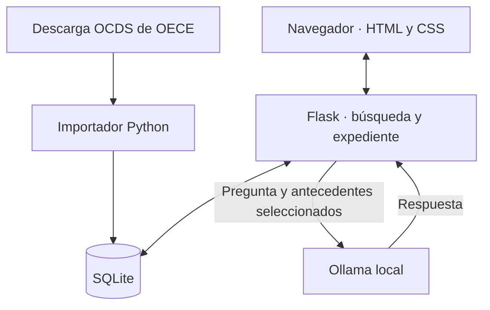

# Radar Público · Prototipo Legaltech EC3

Radar Público ayuda a proveedores, MYPE, encargados de licitaciones y asesores legales a encontrar procedimientos de contratación pública y a contrastar una oportunidad con adjudicaciones publicadas. El problema jurídico-operativo es verificar las condiciones de participación y la información de antecedentes cuando el equipo debe consultar varias fichas, bases y actas. La demostración parte del [prototipo de GitHub](https://github.com/Organization-for-is/front-end/tree/develop) y reconstruye su flujo de búsqueda y expedientes en Python.

## Ponerlo en marcha en Visual Studio Code

1. Descomprime el ZIP y abre la carpeta `radar-publico-python` en VS Code.
2. En **Terminal → Nueva terminal**, ejecuta en Windows:

   ```powershell
   py -m venv .venv
   .\.venv\Scripts\python.exe -m pip install -r requirements.txt
   .\.venv\Scripts\python.exe app.py
   ```

   En macOS y Linux usa:

   ```sh
   python3 -m venv .venv
   .venv/bin/python -m pip install -r requirements.txt
   .venv/bin/python app.py
   ```

3. Abre [http://127.0.0.1:8000](http://127.0.0.1:8000). La app crea la base `instance/radar.sqlite3` y carga siete procesos ficticios para probar el flujo.

El servidor incluido es para desarrollo y demostración local. Para ver qué pasa al pulsar **Buscar**, lee primero la función `buscar()` de `app.py` y luego `templates/index.html`.

## Fuentes de datos y cobertura

| Necesidad | Fuente o implementación |
|---|---|
| Consultar procedimientos vigentes | El [buscador público del SEACE](https://www.gob.pe/32306-como-acceder-a-los-procesos-de-seleccion-convocados-y-en-curso) es la referencia de verificación. La app enlaza esa consulta. La sincronización de vigentes es una fase posterior. |
| Consultar antecedentes | El [Portal de Contrataciones Abiertas OCDS](https://www.gob.pe/52005) publica descargas y documentación de su API. El [registro de datos de OCP](https://data.open-contracting.org/es/publication/135) organiza datos de OECE por año. El [portal analítico de datos abiertos del OECE](https://www.gob.pe/es/14272-acceder-al-portal-de-datos-abiertos-del-oece) también publica históricos y señala que sus conjuntos excluyen procedimientos en marcha o con adjudicación incompleta. |
| Comparar ofertas ganadoras | La app recupera registros de adjudicación y, cuando hay un enlace publicado, permite consultar el documento original. El adjudicatario y el monto publicado por sí solos aportan evidencia limitada sobre el contenido de la oferta y las razones de la adjudicación. |

### Importar un archivo de datos abiertos

Desde el portal OCDS, descarga un archivo de registros en JSON y extrae el ZIP. Usa el JSON que tenga una lista `records` con `compiledRelease`. También puedes usar un `.jsonl` o `.jsonl.gz` de procesos compilados del registro OCP, sin descomprimir el Gzip.

```powershell
.\.venv\Scripts\python.exe app.py --importar "C:\ruta\archivo.jsonl.gz"
```

En macOS y Linux usa `.venv/bin/python app.py --importar "/ruta/archivo.jsonl.gz"`. Luego entra a **Datos importados**. Cada importación actualiza procesos por su OCID. Un registro compilado más antiguo se omite si ya existe una versión posterior. Se cargan adjudicaciones con estado OCDS `active`. También se muestran registros publicados en `awards` sin estado cuando incluyen proveedor y fecha. Se marcan como «Estado sin informar» para contrastarlos con el expediente. Los campos que no vienen en la fuente se muestran como faltantes. La región usada en el filtro corresponde a la dirección publicada de la entidad compradora, cuando está disponible.

La cobertura de la app equivale a los archivos cargados. El alcance, la fecha de corte y los datos faltantes se deben registrar para cualquier muestra usada en la exposición. El conjunto anual puede ser grande. Para una primera carga conviene trabajar con un archivo mensual o una muestra delimitada.

## Activar Ollama

Instala y abre [Ollama](https://ollama.com/download). Descarga el modelo multilingüe propuesto con `ollama pull qwen2.5:3b`. Si el servicio aún no está activo y se ejecuta por terminal, usa `ollama serve` en otra terminal. La app consulta la API local en `127.0.0.1:11434`. Puedes cambiar el modelo con la variable de entorno `OLLAMA_MODEL` antes de iniciar Python.

En **Demostración**, busca **limpieza**, selecciona **Lima**, **Servicios** y **En curso**. Abre el expediente y pulsa **Analizar antecedentes**. La llamada va a Ollama cuando existen adjudicaciones comparables. Si Ollama no está disponible, la tabla de antecedentes sigue accesible.

## Arquitectura



- `app.py` recibe los filtros, consulta SQLite y arma el expediente.
- `datos.py` y `schema.sql` manejan la importación, la persistencia y la relación entre convocatoria y adjudicación.
- `templates/` y `static/style.css` definen la interfaz HTML y CSS.
- `asistente.py` envía a Ollama la pregunta y hasta cinco antecedentes de la misma categoría con términos compartidos en el título. Los montos y adjudicatarios de la tabla salen directamente de SQLite.
- `data/demo.json` contiene únicamente expedientes ficticios.

## Fases y evidencias de avance

| Fase | Entregable y criterio de cierre |
|---|---|
| 1. Buscador local | Búsqueda de texto, filtros por región de la entidad, objeto, estado y año, paginación, ficha y base SQLite. Demostrar con la muestra incluida. |
| 2. Piloto con datos oficiales | Importar una ventana de datos, verificar contra expedientes fuente y documentar cobertura. Validar casos con más de una adjudicación, monedas distintas y campos faltantes. |
| 3. Comparación y Ollama | Probar el modelo real con un expediente y comprobar que cada adjudicatario, monto y referencia puedan verificarse en la tabla y los documentos. Probar también una pregunta para la que falten datos. |
| 4. Vigentes y sincronización | Evaluar fuentes autorizadas de procesos en curso, medir cobertura y retraso y añadir actualización automática. Registrar fuente, fecha de corte, conteos y errores por carga. Evaluar búsqueda indexada y PostgreSQL según el volumen. |
| 5. Exposición | Ensayar el flujo, exportar la presentación a PDF y revisar que los resultados de la demo coincidan con lo que se afirma en las diapositivas. Hacer que todos los integrantes intervengan. |

## Presentación de la EC3

**Guion de 10 minutos**

1. **2 min · Problema y oportunidad.** Mostrar qué hace hoy un proveedor para encontrar una oportunidad, verificar un expediente y buscar adjudicaciones de referencia. Justificar el valor para MYPE, equipos de licitaciones y asesores en Perú.
2. **3 min · Solución y arquitectura.** Mostrar el flujo de datos y explicar el buscador, SQLite y el papel de Ollama. Explicar beneficios, cobertura y controles humanos.
3. **5 min · Demostración.** Buscar y filtrar. Abrir una ficha, revisar dos adjudicaciones, preguntar qué debe verificarse antes de comparar los montos y validar la respuesta con la tabla. Si se usa la muestra ficticia, señalarlo en pantalla. Cerrar con el piloto oficial y la integración de vigentes.

**Contenido del PDF**  
Portada con Radar Público y nombres de integrantes. Problema jurídico y justificación. Usuarios y aplicación peruana. Solución y beneficios. Tecnologías y arquitectura. Evidencia de la demostración. Riesgos, límites y revisión humana. Evolución futura.

**IA y supervisión**  
El equipo debe indicar el modelo realmente probado y su papel como asistente de lectura y comparación. Ollama puede inventar o confundir datos y los expedientes históricos pueden estar incompletos. Revisar los montos, las monedas y los identificadores antes de usar una respuesta. Confirmar requisitos y plazos en las bases y en el SEACE. Mantener la decisión de postular en el equipo responsable. Usar preguntas sin información confidencial durante la exposición.

**Pregunta para otro equipo**  
¿Cómo comprobarían que el resultado de su herramienta sigue siendo confiable cuando la fuente original cambia o está incompleta?
